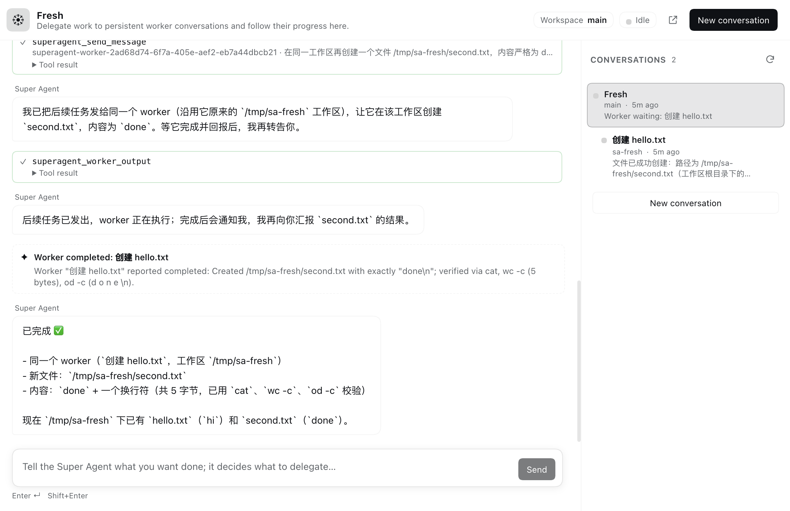

# DSH Super Agent

[](LICENSE)


把 **Super Agent 面板**和 **iPhone 远程控制端点**装成一套，在另一台 Mac 上一条命令装好，
iPhone 上的 DSH Remote 就能像连本机一样连过去。



- **Super Agent**：DSH Web 侧边栏里的委派面板。它自己不碰电脑，把 shell、读写文件、
  搜索、构建、测试、git、浏览、定时任务、文档处理全部交给持久的 worker 会话，并在
  右侧栏跟踪每个 worker 的进度。
- **dsh-remote**：在独立端口（默认 `0.0.0.0:3443`）上提供带 Bearer Token 的
  `/remote-api/*` 与 SSE 事件流，iOS App 通过它读写会话、工作区和 Super Agent。

## 包含什么

| 包 | 作用 | 能否单独安装 |
|---|---|---|
| `@local/dsh-super-agent` | Host + Web 插件：侧边栏面板、编排器、`superagent_*` 工具 | 可以，装进任意 Web/Desktop profile |
| `dsh-remote` | Host 插件：鉴权的 `/remote-api`、`/healthz`、`events.mux` / `events.host` | 可以，不想用 Super Agent 的 profile 只装它 |
| `@local/dsh-suite` | Bundle 层：依赖上面两个包，用一条 patch 同时插入两行 | 这就是一键安装装的东西 |

三个包是同一仓库里的真实目录依赖（`file:../dsh-super-agent`、`file:../dsh-remote`），
**没有任何 `link:` 或指向构建机绝对路径的写法**：安装时三个包一起被复制到
`$DSH_HOME/plugins/@local/dsh-suite/<版本>-<内容哈希>/`，再由 pnpm 装进 profile 的
`node_modules`（真实目录，不是软链）。

```
iPhone (DSHRemote)                    Mac（一个 DSH 进程）
┌────────────────────┐   HTTP+Bearer  ┌──────────────────────────────────┐
│ 服务器列表（多台）   │ ─────────────► │ desktop profile                  │
│ 会话 / 流式 / 工具   │  :3443         │  ├─ dsh-base + dsh-web-app       │
│ Super Agent 入口    │                │  ├─ dsh-super-agent（面板 + 工具）│
└────────────────────┘                │  └─ dsh-remote（/remote-api）     │
                                      └──────────────────────────────────┘
```

> 重要：`dsh-remote` 和 Super Agent 必须在**同一个 DSH 进程**里。iPhone 连到
> desktop profile 的 3443，看到的就是 Mac 本机同一个 workspace、同一份会话。
> 不要为了让手机连上再启动第二个 `dsh web` 去抢 3443。

## 前提条件

| 项 | 要求 |
|---|---|
| DSH | 桌面版 **0.2.1+**（本套件在 0.2.2-rc.1 上验证）；插件面向 0.2.x Host Services |
| Node | 22.19+；**不是必须**，没装 Node 时安装脚本用桌面版自带的 Node/Electron |
| 系统 | macOS（桌面版目前只有 macOS；Linux/Windows 见文末「平台现状」） |
| iPhone | iOS 17+，已安装 DSH Remote App（App 用 Xcode 分发，不在本仓库里） |
| 网络 | Mac 与 iPhone 同一 Wi-Fi/热点，或同一 Tailscale tailnet |

装之前先**打开一次 DeepSeek Harness 桌面版**：首次启动会创建
`~/.dsh/profiles/desktop`（脚本不会替你创建这个保留 profile）。

## 一键安装

在**目标 Mac** 上二选一。

克隆安装（推荐，方便重跑和卸载）：

```sh
git clone git@github.com:CACppuccino/DSH-Super-Agent.git
cd DSH-Super-Agent && ./install.sh --restart
```

不克隆，直接跑（脚本会自己下载仓库压缩包到临时目录）：

```sh
curl -fsSL https://raw.githubusercontent.com/CACppuccino/DSH-Super-Agent/main/install.sh | sh -s -- --restart
```

两者等价。`--restart` 会退出并重开 DeepSeek Harness（仅 macOS + 默认 `~/.dsh`），
让新 bundle 行立即生效，然后自动验证。不想让它动正在用的 App 就去掉 `--restart`，
装完自己「退出并重新打开」一次，再运行 `./install.sh --verify-only`。

脚本依次做这些事：

1. 找 `$DSH_HOME`（默认 `~/.dsh`）和 profile（默认 `desktop`，可用 `--profile`）；
   定位 DSH：桌面版自带 CLI → PATH 上的 `dsh` → `--dsh` 覆盖；
2. 把 `dsh-suite` + `dsh-super-agent` + `dsh-remote` 三个包复制到
   `$DSH_HOME/plugins/@local/dsh-suite/<版本>-<内容哈希>/`（内容哈希保证重装换内容时
   pnpm 不会复用旧文件）；
3. 用桌面版自带的 `dsh` CLI 执行 `dsh plugin --profile desktop add file:<副本>/dsh-suite`，
   失败则回退到 profile 的 `package.json` + `pnpm install`；
4. 规范化 profile：只留一条 `@local/dsh-suite` 依赖和一条 bundle 行，清掉以前单独装过
   两个插件留下的依赖/行/软链（否则两套 patch 会重复插入行）；
5. 确保 `$DSH_HOME/remote/token` 存在且权限 `0600`（已存在就复用，不会覆盖）；
6. 请求 `/healthz`，再带 Token 调一次 `session.list`；失败时打印具体原因和可执行的修复
   步骤，并以非 0 退出；
7. 打印 iPhone 要填的**全部地址**（本机 / 局域网 / Tailscale）和 Token。

整个脚本是幂等的：重复运行只修不坏。

常用参数：

```sh
./install.sh --profile web          # 装进别的 profile（用你自己的 dsh 启动它）
./install.sh --dsh-home /tmp/x      # 非默认 DSH_HOME
./install.sh --port 3455            # 改了 dsh-remote 的 listen.port 时
./install.sh --host 127.0.0.1       # 只监听本机（手机就连不上，仅本机自测）
./install.sh --no-verify            # 只装不验证
./install.sh --verify-only          # 只验证（重装/重启后再跑）
```

`./install.sh --help` 有完整参数说明。指定/覆盖工具链：
`--dsh`（或 `DSH_CLI`）、`--node`（`DSH_NODE`）、`--pnpm`（`DSH_PNPM`）、
`DSH_DESKTOP_APP`（非标准安装位置的桌面版）。

## 首次配对 iPhone

1. iPhone 与 Mac 连同一个 Wi-Fi/热点，或都登录同一 Tailscale tailnet。
2. App 里打开 **服务器** 页 → **添加服务器**。
3. 填写：
   - **名称**：这台 Mac 的名字（例如「MacBook Pro」）；
   - **地址**：`./install.sh` 输出的局域网地址，例如
     `http://172.20.10.4:3443/remote-api`；
   - **Bearer Token**：`./install.sh` 打印的 64 位 token（存在
     `$DSH_HOME/remote/token`，权限 0600）；
   - **备用地址**（推荐）：把 Tailscale 地址填进去，例如
     `http://100.124.162.74:3443/remote-api`。主地址不可用时 App 会按顺序尝试。
4. 点 **测试连接**，看到 `成功: dsh-remote 0.1.0 @ /remote-api` 后点
   **保存并连接**。
5. 回到主界面，侧边栏出现这台机器的会话列表和 **Super Agent** 入口即成功。

真机不要填 `127.0.0.1`（那是手机自己）；模拟器可以用。

## 在几台 Mac 之间切换

每台 Mac 装一次、在 App 里各存一条服务器记录，token 每台不同：

- 切换：**服务器** → 点目标机器那条 → **更新并连接**；App 会记住当前机器。
- 两台机器的会话、workspace、Super Agent 目录各自独立，互不同步；手机上看到的是
  当前连接那台机器的数据。
- 建议在每条记录里同时填局域网和 Tailscale 两个地址，出门/回家都不用改。
- 不要用「编辑同一条记录」的方式覆盖另一台机器；删掉旧的再加更不容易混。

## 验证与排错

手动验证（不依赖安装脚本）：

```sh
TOKEN="$(cat ~/.dsh/remote/token)"
curl -fsS http://127.0.0.1:3443/healthz
# {"ok":true,"service":"dsh-remote","version":"0.1.0",...}
curl -fsS -H "Authorization: Bearer $TOKEN" \
  -H 'content-type: application/json' \
  -d '{"rpcId":"check","payload":{}}' \
  http://127.0.0.1:3443/remote-api/session.list
# {"type":"server-response", ...,"result":{"ok":true,"value":{"items":[...]}}}
```

| 症状 | 原因 | 处理 |
|---|---|---|
| `healthz` 连接被拒 / 超时 | DSH 没运行，或新 bundle 行还没加载 | 退出重开 DeepSeek Harness；`./install.sh --verify-only` |
| `401 unauthorized` | Token 与进程里加载的不一致 | 确认 profile patch 没写死 `auth.token`；删 token 文件 → 重启 DSH → 重新配对 |
| `/healthz` 返回 HTML 或别的 JSON | 3443 被别的程序占用 | 见「端口冲突」，改端口 |
| `404` / `not found` | 地址漏了 `/remote-api`，或前缀被改过 | 地址必须是 `http://<IP>:3443/remote-api` |
| 手机连不上、Mac 本机正常 | 监听在 `127.0.0.1`、防火墙拦截、不在同一网络 | 改 `listen.host: 0.0.0.0`、放行防火墙、检查 Tailscale |
| App 里没有 Super Agent 入口 | App 连的是旧版本/另一台机器 | 服务器页确认当前机器；Mac 侧重开 App |
| 面板出现但点开空白 | Web 端 client 半加载失败 | 看 DSH 启动日志；确认 profile 里 bundle 行是 `@local/dsh-suite` |

日志：

- DSH 启动日志：`$DSH_HOME/logs/startup-*.log`
- 桌面版日志：`~/Library/Logs/DeepSeek Harness/`
- 插件管理操作日志：`$DSH_HOME/profiles/<profile>/.plugin-manager/logs/`

## 端口冲突

默认 `0.0.0.0:3443`（iPhone App 默认值）。被占用时（`EADDRINUSE`，或 `/healthz`
被别的服务响应）改 profile 的 `cordis.patch.yml`——**整行 config 会被替换**，所以
要把所有键写全：

```yaml
- id: dsh-remote
  config:
    enabled: true
    path: /remote-api
    listen:
      host: 0.0.0.0
      port: 3455
    auth:
      tokenFile: null        # null = 用 $DSH_HOME/remote/token
    maxBodyBytes: 33554432
```

然后重启 DSH，并用 `./install.sh --port 3455` 生成/验证新地址。

同一个 `DSH_HOME` 下不要同时让两个进程抢 3443：第二个进程的 dsh-remote 会启动失败
并在日志里报 `EADDRINUSE`。需要并行时给其中一个 profile 改端口。

## 防火墙与本地网络权限

- macOS 首次监听 `0.0.0.0` 会弹「是否允许应用接受传入网络连接」→ **允许**；
  也可以到 系统设置 → 网络 → 防火墙 → 选项 里放行 DeepSeek Harness。
- iPhone 首次连接会弹「允许 DSHRemote 查找本地网络设备」→ **允许**
  （设置 → 隐私与安全性 → 本地网络）。
- Tailscale 流量走 tailnet，不需要路由器端口映射；也**不要**把 3443 直接映射到公网。

## 局域网 vs Tailscale

| | 局域网 | Tailscale |
|---|---|---|
| 地址 | `http://<Mac 的 LAN IP>:3443/remote-api` | `http://100.x.y.z:3443/remote-api` |
| 前提 | 同一 Wi-Fi/热点 | 两台设备登录同一 tailnet |
| 加密 | 无（明文 HTTP + Token） | WireGuard 已加密 |
| 稳定性 | IP 会变，换网络要改 | 地址稳定，跨网络可用 |
| 建议 | 家里/办公室快速用 | **推荐**；作为 App 的备用地址 |

安装脚本会自动识别 `en0` 等局域网地址和 Tailscale（`100.64.0.0/10`、`fd7a:…`
以及 `tailscale ip -4`）并打印出来。

## 安全警告

**Token = 这台 Mac 的完整控制权。** 它能读写文件、执行命令、改配置、看所有会话，
和 DSH Web 前端同权限甚至更高。请当 root 密码对待：

- 只填进自己的手机；不要发到聊天、截图、issue、仓库或日志。
- 文件默认 `0600`；不要改宽权限，不要放进共享目录。
- 怀疑泄漏：删除 `$DSH_HOME/remote/token` → 重启 DSH 会自动生成新 token，
  再到 App 里更新（旧 token 立即失效）。
- 局域网 HTTP 是明文，同网段的人可以嗅探；跨网络请用 Tailscale，
  或给 dsh-remote 配 TLS：

```yaml
- id: dsh-remote
  config:
    enabled: true
    path: /remote-api
    listen: { host: 0.0.0.0, port: 3443 }
    tls:
      certFile: /path/to/cert.pem
      keyFile: /path/to/key.pem
    auth: { tokenFile: null }
    maxBodyBytes: 33554432
```

自签名证书时在 App 里填证书公钥的 SPKI SHA-256（Base64，可选字段）。
**不要**在无 TLS 的情况下把 3443 暴露到公网。

## 覆盖/停用配置

profile 自己的 `$DSH_HOME/profiles/<profile>/cordis.patch.yml` 在 bundle 层之后应用，
可以按行覆盖（同样是整块 config 替换）。只关掉远程端点：

```yaml
- id: dsh-remote
  config: { enabled: false }
```

只想保留远程端点、不要 Super Agent 面板：不要装套件，直接把
`packages/dsh-remote/` 作为 bundle 单独装进 profile
（`dsh plugin --profile <name> add file:<目录>`）；`dsh-remote` 的 patch 只插入
远程一行，不依赖 Super Agent。

## 卸载

```sh
./uninstall.sh                 # 默认 desktop profile
./uninstall.sh --profile web
```

会从 profile 里移除套件的依赖和 bundle 行（以及残留的两个插件依赖），并尽量用
pnpm 清理 `node_modules`；**Token 和 Super Agent 状态保留**。重启 DSH 后侧边栏和
3443 端点消失。

```sh
./uninstall.sh --purge
```

额外删除：`$DSH_HOME/remote/token`、`$DSH_HOME/state/dsh-super-agent`（当前 profile
的目录）、`$DSH_HOME/plugins/@local/dsh-suite`。
**不会删除** `$DSH_HOME/sessions` 里 DSH 自己的会话历史；需要清空请自行处理。

## 仓库结构

```
DSH-Super-Agent/
├── install.sh                 # 一键安装入口（克隆 或 curl | sh）
├── uninstall.sh               # 卸载入口
├── packages/
│   ├── dsh-super-agent/       # Host + Web 插件：面板、编排器、superagent_* 工具
│   │   ├── index.js           # Host 入口：服务、Session 钩子、HTTP 路由
│   │   ├── client.js          # 侧边栏入口、面板外壳、内嵌原生 chat、历史栏
│   │   ├── lib/               # orchestrator / state / api
│   │   └── test/              # node --test
│   ├── dsh-remote/            # Host 插件：/remote-api + Bearer 鉴权 + SSE
│   │   ├── lib/               # index / compat（0.2.x 协议翻译）
│   │   ├── scripts/           # gen-token、独立安装脚本
│   │   └── tests/             # node --test
│   └── dsh-suite/             # Bundle + 安装器
│       ├── install.sh         # 实际安装流程（POSIX sh）
│       ├── uninstall.sh
│       ├── cordis.patch.yml   # 一条 patch 插入两行
│       ├── scripts/           # installer.mjs + shell-lib.sh + lib/
│       └── test/              # node --test
├── LICENSE
└── README.md
```

- **为什么一个 bundle 包 + 两个独立包**：两个插件职责不同，`dsh-remote` 必须能装到
  不想用 Super Agent 的 profile；套件只负责「一起装、一条 patch 插两行」。
- **为什么安装时复制三个包**：profile 的 bundle 行按包名解析，pnpm 需要真实目录；
  复制到一个带内容哈希的目录后，`file:` 依赖和重装都是确定的，不依赖构建机路径。

## 开发与测试

```sh
node --test test/*.test.js                     # packages/dsh-super-agent
npm test                                       # packages/dsh-remote
npm test                                       # packages/dsh-suite
```

三个测试套件都只用进程内 fake 和临时目录，不需要模型、不需要正在运行的 DSH。

改了插件后不用同步任何 vendor 目录：安装时直接从 `packages/` 复制。

## 平台现状

目前**完整可用的是 macOS + DeepSeek Harness 桌面版**：

- 安装脚本本身是 POSIX `sh`，参数解析、URL/Token 渲染、profile manifest 编辑、
  `/healthz` + `session.list` 验证都不依赖 macOS；`curl | sh` 形式也一样。
- macOS 专属：
  - `--restart` 用 `osascript` 退出、`open -a` 重开桌面版；
  - 桌面版 CLI 的默认探测路径 `/Applications/DeepSeek Harness.app/.../runtime/cli/bin/dsh`；
  - 桌面版自带 pnpm 的路径 `.../runtime/primary-runtime/dependencies/pnpm/bin/pnpm.mjs`；
  - 防火墙 /「本地网络」权限提示。
- 用 `--dsh` / `--node` / `--pnpm` / `DSH_DESKTOP_APP` 可以绕开所有探测。
- Linux：把上述路径换成 npm 安装的 `dsh` 即可；`--profile web`（或自建 profile）
  启动自己的进程，安装脚本本身可直接跑（地址探测走 `os.networkInterfaces()`，
  无 macOS 依赖）。
- Windows：需要把 `install.sh` 换成 PowerShell/批处理包装（或 WSL/Git Bash）；
  `dsh plugin` 需要 pnpm 的 `.cmd` shim（DSH 自己在 Windows 上已处理 shell 标志），
  脚本里的 `osascript`/`open` 分支要替换，路径探测改为 `%LOCALAPPDATA%`／
  安装目录。纯逻辑（Node 部分）跨平台。

## 许可

[MIT](LICENSE)
