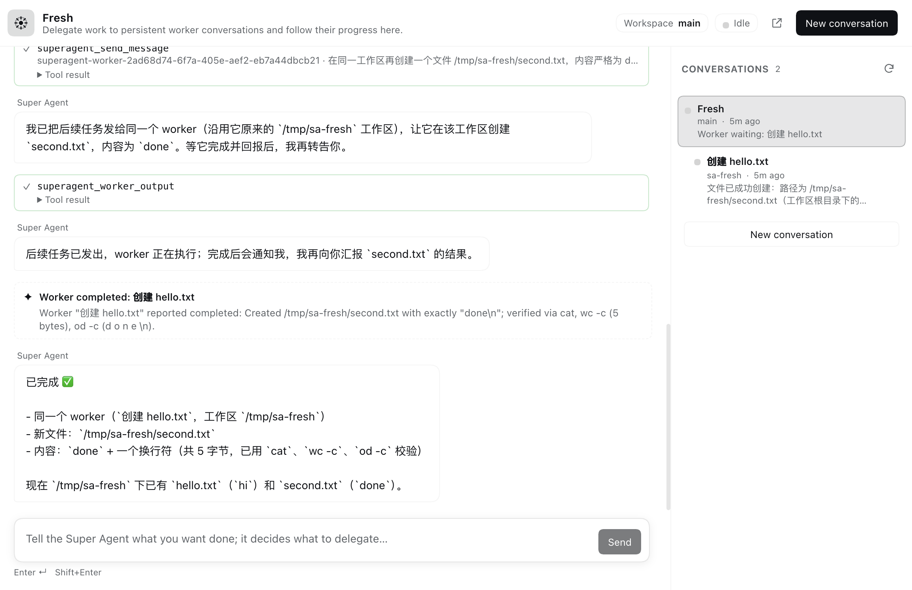

# dsh-super-agent



A DeepSeek Harness plugin that adds a **Super Agent** conversation panel on the left sidebar, above **Plugins**.

The Super Agent is a persistent orchestrator. It does not operate the computer itself: shell commands, file reads/writes, searches, builds, tests, git, browsing, scheduling, and document work all go to a worker conversation. Through ordinary conversation the Super Agent can:

- create a new worker conversation and hand it a complete task brief;
- follow up with, inspect, or stop existing workers;
- create workspaces and run work across different workspace directories;
- open additional Super Agent conversations for separate long-running threads;
- receive worker progress notices as hooks on Session events and relay them to the user.

The panel shows the active Super Agent chat in the center and a conversation history rail on the right. The rail groups workers under the Super Agent conversation that launched them; clicking a conversation opens its detail. The Super Agent center embeds the stock DSH `conversation.content` factory (the same chat/composer surface as a normal conversation), wrapped in the retained Session's `SessionProvider`; a slim strip above it keeps the live worker count and latest progress visible. Worker conversations stay in the panel's compact read-only transcript and can be opened in the normal DSH conversation view. Assistant replies and worker progress render Markdown through the stock `@deepseek-ai/dsh-client-ui-primitives` `MarkdownText` component, so headings, lists, links, tables, and fenced code blocks use the same styling, sanitization, and copy behavior as the built-in chat.

## Install

One command for the whole stack (this panel + the `dsh-remote` endpoint the iPhone app
talks to): clone the repository and run `./install.sh --restart`. See the
[repository README](../../README.md) for the macOS requirements, the iPhone pairing steps,
and uninstalling.

Install this directory alone as a bundle through the Harness Plugin Manager (or `plugin_manager` `install_bundle` with the absolute package directory). The bundle patch inserts one row, `dsh-super-agent`; the Client half loads from `./client`.

For a profile launched by the `dsh` CLI, the equivalent command is:

```sh
dsh plugin --profile "$DSH_PROFILE" add <absolute path to this directory>
```

State is kept under `$DSH_HOME/state/dsh-super-agent/` (override with `DSH_SUPERAGENT_STATE_DIR`). Desktop keeps that historical root; every other profile uses `$DSH_HOME/state/dsh-super-agent/profiles/<profile>/`, so two DSH processes sharing one home never write the same JSON catalog. The directory contains the conversation catalog and the default workspace directories. Worker sessions are normal DSH Sessions and persist like any other conversation.

## Using it

1. Click the **Super Agent** icon in the left sidebar. It is above **Plugins**.
2. The first open creates a Super Agent conversation in `state/dsh-super-agent/workspaces/main`.
3. Ask for work, for example:

   > 在 `~/Projects/demo` 里创建一个 worker，调查测试失败的原因，并给出修复建议。

   The Super Agent calls `superagent_dispatch_task`, creates a worker Session in that workspace, and tells you the worker id. As the worker reports or finishes a turn, a progress notice wakes the Super Agent and it relays the meaningful part.
4. Use the right rail to inspect the worker conversation. Click **Open full conversation** to see it in the normal DSH conversation view.
5. **New conversation** can place a new Super Agent conversation in any workspace the Harness knows, or create a new workspace path. The workspace picker includes all registered workspaces, not only the ones this plugin created.

## Model tools

Super Agent sessions receive:

| Tool | Purpose |
| --- | --- |
| `superagent_dispatch_task` | Create a worker conversation in a workspace and send it a brief. |
| `superagent_send_message` | Send a follow-up or answer to a worker. |
| `superagent_list_workers` | List workers with live status. |
| `superagent_worker_output` | Read a worker's latest output and recent progress. |
| `superagent_stop_worker` | Stop a worker's current turn. |
| `superagent_create_workspace` | Prepare a workspace. |
| `superagent_create_conversation` | Open another Super Agent conversation. |
| `superagent_list_conversations` | List all Super Agent and worker conversations. |

Worker sessions receive `superagent_report_progress`, which records progress and relays a notice to the parent Super Agent immediately.

Super Agent sessions are additionally **denied the built-in host-side tools**: shells and terminals (`bash`, `pwsh`, `terminal_*`), filesystem read/write/patch (`read`, `write`, `edit`, `apply_patch`, `str_replace_editor`, `read_image`), search (`glob`, `grep`), background jobs (`job_*`), web (`web_search`, `web_fetch`), host/plugin/runtime inspection (`working_directory`, `load_workspace_dependencies`, `plugin_manager`, `cordis_inspect_*`, `create_worktree`), session-log inspection (`session_*`), scheduling (`schedule_*`), skill loading (`skill`), presentation (`present`), question cards (`ask_user_question`), and one-shot delegation (`subagent`, `subagent_fork`, `workflow`, `ralph`, team tools). Planning-only tools (`todo_write`, goal tools, `exit_plan_mode`) remain. The deny list is applied one name at a time and retried on `tools/change`, so it holds regardless of when a preset registers a tool.

## Architecture

```
index.js                  Host entry: services, Session hooks, HTTP routes
lib/orchestrator.js       Conversations, workspaces, dispatch, progress relay
lib/state.js              Atomic JSON catalog and bounded progress log
lib/api.js                Same-origin panel API
client.js                 Sidebar entry, panel shell, embedded stock chat, history rail
locale/, icon.svg         Plugin Manager metadata
test/                     Node test suite for host and client logic
```

The Host half uses the live Harness services `agents`, `sessionController`, `workspaceRegistry`, `systemPrompt`, `tools`, and `webServer`. It decorates an Agent when its Session belongs to the catalog:

- Super Agent: a fixed orchestrator prompt and eight tools, registered on the Agent's scoped `tools` and `systemPrompt`; the built-in one-shot `subagent`, `workflow`, and teammate tools are denied so delegation stays on the tracked worker path.
- Worker: a worker prompt and `superagent_report_progress`.

Worker progress is observed two ways:

1. `session/event` hooks update status and, on `turn/end`, read the last assistant message and send a notice to the parent.
2. `superagent_report_progress` lets a worker report mid-turn.

Notices are delivered through the parent Agent's inbox with the producer-owned `dsh-super-agent` source and the `notice` form, so the built-in transcript presents them as compact context while this panel styles them as progress rows.

The Client half uses the public Client services `sessions`, `uiWorkspace`, `slots`, and `locale`. It retains the selected Session with `ctx.sessions.retain` and subscribes to its Session and event snapshots, so the chat is live without polling the transcript. The catalog (conversation status, workspace, last message) polls a small same-origin API every 2.5 seconds.

## Tests

```sh
node --test test/*.test.js
```

The suite covers the state store, dispatch/workspace/progress orchestration, HTTP authorization and routes, and the Client's pure transcript/grouping registration logic. It uses in-process fakes and temporary directories; no model or live Session is needed.

## Remote and multiple profiles

- Install the bundle into the profile that serves the remote connection. The host half then decorates the Super Agent session with its prompt and tools in that process.
- The custom sidebar, panel, and history rail are DSH **Web client** plugins. The native `dsh-remote` iOS app is a SwiftUI client: it lists Sessions and renders their chat/tool cards, not Web client slots. It can open the Super Agent **session** and converse, and its session and workspace lists replace the panel's history rail; the panel itself does not appear there.
- `dsh-remote` and the web profile must speak the same DSH protocol. This plugin was verified against the web profile's Web UI. If the remote bridge is pinned to an older DSH API, that bridge must be updated separately before the iOS app can list or stream any Session.

## Stock conversation surface

The Super Agent center uses the stock `conversation.content` slot factory, so slash commands, attachments, the model picker, skill pickers, approval cards, question cards, and chat/composer plugin slots behave as they do in a normal conversation. It is behind a reversible flag:

```js
localStorage.setItem('dsh-super-agent:stock-chat', '0')
```

Reload the page to use the previous hand-rolled transcript instead; remove the key (or set it to `1`) to return to the stock surface. The stock surface is wrapped in an error boundary and falls back to the previous transcript if it cannot mount. Worker conversations intentionally remain on the compact read-only transcript so the panel cannot send prompts to a worker.

## Notes and limits

- This is a research-oriented plugin. It adapts concepts from `deepseek-ai/dsh-superagent-prototype` (persistent worker Sessions, workspace-per-task, progress reports) into a conversational panel.
- The panel uses the public Session retention API with the `gateway` source. A future Harness API may expose a plugin-specific consumer source.
- Worker status is durable. A worker that was mid-turn when the Host stopped returns as waiting; a dispatch interrupted during creation is shown as paused until it receives a follow-up.
- The Super Agent is orchestration-only: host-side tools are denied in its scope, so work cannot run in the main conversation even when the model tries. The prompt reinforces the same boundary.
- `ask_user_question` is denied for Super Agent and worker conversations, and a fail-fast guard rejects a stray call. The panel has no question-card UI, so both prompts ask questions as plain text in a normal message.
