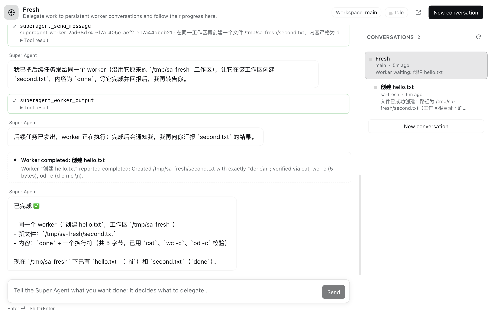

# dsh-super-agent



A DeepSeek Harness plugin that adds a **Super Agent** conversation panel on the left sidebar, above **Plugins**.

The Super Agent is a persistent orchestrator. It does not operate the computer itself: shell commands, file reads/writes, searches, builds, tests, git, browsing, scheduling, and document work all go to a worker conversation. Through ordinary conversation the Super Agent can:

- create a new worker conversation and hand it a complete task brief;
- follow up with, inspect, or stop existing workers;
- create workspaces and run work across different workspace directories;
- open additional Super Agent conversations for separate long-running threads;
- receive worker progress notices as hooks on Session events and relay them to the user.

The panel shows the active Super Agent chat in the center and a conversation history rail on the right. The rail groups workers under the Super Agent conversation that launched them; clicking a conversation opens its detail. Below the conversation list, a **待决策项 / Pending decisions** section lists unanswered questions the Super Agent registered with `superagent_pending_decision`. Both rail sections collapse independently and remember their state across reloads. Clicking a pending item opens its question card in the main conversation area with optional context, choice buttons, and a free-text answer; submitting removes it from the rail, shows the answered state briefly, then collapses the card automatically while the answer is delivered to the Super Agent as a user message. The Super Agent center embeds the stock DSH `conversation.content` factory (the same chat/composer surface as a normal conversation), wrapped in the retained Session's `SessionProvider`; the title shows the total and in-progress worker counts (`12 workers · 3 running`) and a slim strip above it keeps the latest progress visible. The same total + running summary is repeated in the right-rail header, so it is visible whichever header the reader looks at. Workers can carry several short tags (for example `quant`, `dsh`, `infra`, `memory`). Tags are editable from the worker detail or by the Super Agent through `superagent_worker_tags`, appear in the conversation rail, and drive a multi-select filter (`any` semantics) whose selection survives reloads. The stock turn-navigation rail on the right edge of the conversation is decorated in place: each turn takes the colour of the worker it touched, a multi-tag turn shows a primary colour plus a secondary stripe, and hovering a marker lists its tags. A legend appears while a tag filter is active. Marker buttons, jump handlers, virtualization, and keyboard behaviour stay stock; the plugin only adds attributes, a tooltip, and two CSS variables. Worker conversations stay in the panel's compact read-only transcript and can be opened in the normal DSH conversation view. Assistant replies and worker progress render Markdown through the stock `@deepseek-ai/dsh-client-ui-primitives` `MarkdownText` component, so headings, lists, links, tables, and fenced code blocks use the same styling, sanitization, and copy behavior as the built-in chat.

## Install

One command for the whole stack (this panel + the `dsh-remote` endpoint the iPhone app
talks to): clone the repository and run `./install.sh --restart`. See the
[repository README](../../README.md) for the macOS requirements, the iPhone pairing steps,
and uninstalling.

Install this directory as a bundle through the Harness Plugin Manager (or `plugin_manager` `install_bundle` with the absolute package directory). The bundle patch inserts one row, `dsh-super-agent`; the Client half loads from `./client`.

For a profile launched by the `dsh` CLI, the equivalent command is:

```sh
dsh plugin --profile "$DSH_PROFILE" add <absolute path to this directory>
```

State is kept under `$DSH_HOME/state/dsh-super-agent/` (override with `DSH_SUPERAGENT_STATE_DIR`). Desktop keeps that historical root; every other profile uses `$DSH_HOME/state/dsh-super-agent/profiles/<profile>/`, so two DSH processes sharing one home never write the same JSON catalog. The directory contains the conversation catalog (`state.json`), the durable pending-decision queue (`pending.json`), and the default workspace directories. Both JSON files are written atomically. Worker sessions are normal DSH Sessions and persist like any other conversation.

## Using it

1. Click the **Super Agent** icon in the left sidebar. It is above **Plugins**.
2. The first open creates a Super Agent conversation in `state/dsh-super-agent/workspaces/main`.
3. Ask for work, for example:

   > 在 `~/Projects/demo` 里创建一个 worker，调查测试失败的原因，并给出修复建议。

   The Super Agent calls `superagent_dispatch_task`, creates a worker Session in that workspace, and tells you the worker id. As the worker reports or finishes a turn, a progress notice wakes the Super Agent and it relays the meaningful part.
4. Use the right rail to inspect the worker conversation. Click **Open full conversation** to see it in the normal DSH conversation view.
5. When the Super Agent needs a decision, it registers a pending item. The **待决策项 / Pending decisions** section below the conversation list shows it; click the item, choose an option or type an answer, then submit. The item leaves the rail, the card shows the answered state briefly and then collapses automatically, and the Super Agent receives the answer as a user message. Both rail sections have independent collapse buttons whose state survives a reload.
6. **New conversation** can place a new Super Agent conversation in any workspace the Harness knows, or create a new workspace path. The workspace picker includes all registered workspaces, not only the ones this plugin created.

## Workspace discipline and themes

Every dispatch is classified into a **theme** (for example `quant-research`, `dsh-plugin`, `infra-ops`, `memory`, `windows-node`, `backup`, or a more specific id). Themes are not just labels: the plugin persists a `theme -> workspaceId` registry in `state.json` (and seeds the known theme ids, titles, and descriptions on first load) so a new worker conversation for a known theme **reuses** the theme's canonical workspace instead of creating another directory.

`superagent_dispatch_task` takes `theme` and an optional `justification`. The behaviour is deliberately explicit:

- a known theme with a registered workspace is reused; the result says `workspace_created: false`, `workspace_reused: true`, and echoes the normalized `theme`;
- `new_workspace` is still honored for a genuinely separate deliverable, and the result says `workspace_created: true`;
- an unknown theme, or a theme without a workspace, refuses to create a directory unless `new_workspace` or `justification` is supplied; the new workspace is then registered under the theme;
- every dispatch result surfaces `theme`, `workspace_created`, and `workspace_reused`, so the Super Agent can tell the user, and no workspace is created silently.

`superagent_workspaces` is the discovery surface: `list` inventories every SA workspace (worker counts, live/idle/stopped breakdown, last activity, directory emptiness, proposed theme groups), `themes` lists the persisted registry, `assign` maps a theme to an existing workspace, and `suggest` classifies a task description into the best theme + workspace. If `suggest` returns a proposed workspace for a known but unassigned theme, dispatch with that workspace id (or assign it first) instead of creating a new directory. Proposed groups are **hints only**; retiring or merging workspaces is a separate, dry-run consolidation step for the user to approve, and existing worker conversations are never moved.

## Model tools

Super Agent sessions receive:

| Tool | Purpose |
| --- | --- |
| `superagent_dispatch_task` | Create a worker conversation in a workspace and send it a brief. |
| `superagent_send_message` | Send a follow-up or answer to a worker. |
| `superagent_list_workers` | List workers with live status. |
| `superagent_worker_output` | Read a worker's latest output and recent progress. |
| `superagent_worker_tags` | Set/add/remove short tags on a worker, or list the many-to-many tag index. |
| `superagent_workspaces` | Inventory workspaces and proposed theme groups, list/assign the persisted theme registry, or suggest a theme for a task. |
| `superagent_stop_worker` | Stop a worker's current turn. |
| `superagent_create_workspace` | Prepare a workspace. |
| `superagent_create_conversation` | Open another Super Agent conversation. |
| `superagent_list_conversations` | List all Super Agent and worker conversations. |
| `superagent_pending_decision` | Register an inline pending decision (`create`), list unanswered decisions (`list`), or record an answer (`resolve`) for this Super Agent conversation. The panel renders the card and sends the user's answer back as a user message. |

Worker sessions receive `superagent_report_progress`, which records progress and relays a notice to the parent Super Agent immediately.

Super Agent sessions are additionally **denied the built-in host-side tools**: shells and terminals (`bash`, `pwsh`, `terminal_*`), filesystem read/write/patch (`read`, `write`, `edit`, `apply_patch`, `str_replace_editor`, `read_image`), search (`glob`, `grep`), background jobs (`job_*`), web (`web_search`, `web_fetch`), host/plugin/runtime inspection (`working_directory`, `load_workspace_dependencies`, `plugin_manager`, `cordis_inspect_*`, `create_worktree`), session-log inspection (`session_*`), scheduling (`schedule_*`), skill loading (`skill`), presentation (`present`), question cards (`ask_user_question`), and one-shot delegation (`subagent`, `subagent_fork`, `workflow`, `ralph`, team tools). Planning-only tools (`todo_write`, goal tools, `exit_plan_mode`) remain. The deny list is applied one name at a time and retried on `tools/change`, so it holds regardless of when a preset registers a tool.

## Architecture

```
index.js                  Host entry: services, Session hooks, HTTP routes
lib/orchestrator.js       Conversations, workspaces, dispatch, progress relay
lib/state.js              Atomic JSON catalog (workspaces, per-worker tags, theme registry) and bounded progress log
lib/pending.js            Atomic pending-decision queue
lib/api.js                Same-origin panel API
lib/billing.js            Account balance, Platform per-key spend, local 24-hour tokens
client.js                 Sidebar entry, panel shell, embedded stock chat, history rail
locale/, icon.svg         Plugin Manager metadata
test/                     Node test suite for host and client logic
```

The Host half uses the live Harness services `agents`, `sessionController`, `workspaceRegistry`, `systemPrompt`, `tools`, and `webServer`. It decorates an Agent when its Session belongs to the catalog:

- Super Agent: a fixed orchestrator prompt and eleven tools, registered on the Agent's scoped `tools` and `systemPrompt`; the built-in one-shot `subagent`, `workflow`, and teammate tools are denied so delegation stays on the tracked worker path.
- Worker: a worker prompt and `superagent_report_progress`.

Worker progress is observed two ways:

1. `session/event` hooks update status and, on `turn/end`, read the last assistant message and send a notice to the parent.
2. `superagent_report_progress` lets a worker report mid-turn.

Notices are delivered through the parent Agent's inbox with the producer-owned `dsh-super-agent` source and the `notice` form, so the built-in transcript presents them as compact context while this panel styles them as progress rows.

The Client half uses the public Client services `sessions`, `uiWorkspace`, `slots`, and `locale`. It retains the selected Session with `ctx.sessions.retain` and subscribes to its Session and event snapshots, so the chat is live without polling the transcript. The catalog (conversation status, workspace, last message) polls a small same-origin API every 2.5 seconds.

## Tests

```sh
node --test test/*.test.js
```

The suite covers the state store (including tag normalization and persistence, theme registry persistence), the pending-decision store, dispatch/workspace/progress orchestration (including theme reuse, explicit new workspaces, justification enforcement, registry persistence, inventory grouping, and description-to-theme suggestion), HTTP authorization and routes (including pending create/list/resolve, worker tag set/list, workspace/theme inventory+assignment, and answer delivery), the Client's pure transcript/grouping/registration logic, worker count derivation, tag filter any-of semantics and persistence, deterministic tag colours, turn-ownership mapping and turn-rail marker decoration, rail section ordering and collapse persistence, the inline pending card, tag chips/editor, the turn legend, and the header widget's balance/usage folding, fallback, and formatting. It uses in-process fakes and temporary directories; no model or live Session is needed.

## 余额与 24 小时用量（标题栏状态组件）

Super Agent 面板标题栏右侧有一个紧凑状态组件。它显示的是**两个不同窗口的数**，不能相加或互相换算：

- **余额**：显示当前登录 DeepSeek 账户的钱包余额（CNY/USD，带币种符号）。数据来自宿主可选的账户服务 `deepseekAccount.getBalance({version, locale, timezoneOffsetSeconds})`（DSH 0.2.2 起；旧版的 `accountController` 同名同语义，仍作为后备读取），与 `dsh-remote` 的 `host.balance` 同源；未登录、读取失败，或当前 profile 没有该服务时显示 `—`，不会显示 0。
- **今日（Platform 日，含时区）**：每个 API key 的消费，来自 DeepSeek Platform 用量页使用的私有接口 `GET https://platform.deepseek.com/api/v0/usage/by_api_key/cost?start=<unix>&end=<unix>&tz=<offset>`，使用账户登录后已经保存在凭据存储里的 grant（`x-dsh-auth-token`），不新增任何登录或浏览器认证面。接口按 `86400` 秒的日历日分桶，因此金额是**今日**（按界面时区），不是滚动 24 小时。
- **滚动 24h（本地计算）**：同一列表下方按 **provider 路由**（`deepseek-official` = API key 路由，`deepseek-account` = 账户路由）汇总最近 24 小时本地 Session 日志中 `assistant/message.data.usage` 的 provider 上报 token（输入、输出、缓存读/写、请求数）。这是精确的滚动 24 小时 token 数，完全在本地计算。
- 列表中的 API key 直接来自 Platform 响应的 `api_key` 系列，支持 0/1/N 个 key（当前账户实测返回 AutoQuant / DeepSeek Harness / MacClaudeCode），不依赖 `~/.dsh/.credentials.yaml` 里是否有 key 记录。为了列出“今日 0 消费但最近仍活跃”的 key，金额请求使用“昨天 + 今天”的 key 枚举窗口，只累加今天的桶；因此 Harness 今日 `¥0.00` 也会显示。只保留 `api_key.name`（或派生的 `key-<hash6>` 短标签）、12 位哈希 id、类型、模型和金额；`sensitive_id` 与 `tracking_id` 在解析边界丢弃，不写入缓存、日志、API 响应或错误。
- 每 60 秒刷新，窗口重新获得焦点或页面重新可见时也会刷新。请求失败时保留上一次成功结果，不向面板抛错误。面板宽度小于 820px 时只保留余额胶囊，展开面板仍包含全部列表。
- 只显示 key 名称/派生短标签、provider 路由名和数量，不读取、不输出任何密钥值。

**私有接口与失败行为（重要）**：

- `by_api_key/cost` 是 Platform 控制台页面使用的**私有、未文档化接口**（社区记录见 [CodexBar 的 DeepSeek 文档](https://github.com/steipete/codexbar/blob/main/docs/deepseek.md)），可能随时改动或失效。
- 请求有 4 秒超时；任何非 200、`code != 0`、`biz_code != 0`、JSON/结构变化或字段损坏都会 fail-closed 为 `failed`，不重试、不写错误日志、不阻塞面板，UI 自动退回“仅滚动 24h token”模式。余额与 token 不受影响。
- 金额缓存按 **(Platform 日, 时区)** 键，默认 5 分钟；跨过本地午夜键自然变化。token 缓存 30 秒。两者都不会写入磁盘。
- **Kill switch**：在 profile 的 `cordis.patch.yml` 里关闭私有接口，组件只显示本地滚动 24h token：

```yaml
- id: dsh-super-agent
  config:
    platformSpend: false
```

**准确性说明**：

- 金额是“今日”日历日桶，**不是滚动 24 小时**；滚动 24 小时只有本地 token 数。不要把它当成“过去 24 小时花了多少钱”。
- Harness 的 LLM 注册表没有文本 token 单价表（只有图片请求计价），因此无法从本地 token 诚实地折算金额；金额只来自 Platform 返回值。
- 余额来自账户钱包，而每个 API key 的消费来自 Platform 的按 key 账单；两者口径可能不同，不应被当作同一本账。
- Platform 没有公开的按密钥计费 API；API key 本身无法读取私有控制台接口（实测返回 `code: 40003`），必须使用控制台会话 token。如果账户未登录、grant 过期，或私有接口不可用，金额显示 `—`/提示，token 仍照常显示。
- 金额依赖账户 provider 当前写入的 `deepseek-account-platform/default` 凭据记录；如果未来 DSH 改动该记录或 token 形式，私有接口会失败并自动退回 token 模式。
- 刚结束的请求可能还在持久化批处理中，或 Platform 账单尚未刷新；最多等下一轮 60 秒刷新即可。

数据由宿主新增的 `GET /superagent/api/usage` 提供，和 `/state` 共用同一套同源校验（`x-superagent-request: 1`、Host/Origin 匹配），没有新增浏览器认证面。余额只走账户服务；Platform 金额只读账户 grant 并请求上述私有接口；本地 token 只读 `ctx.sessionPersistence` 暴露的 Session 日志，不会启动模型请求。

## Remote and multiple profiles

- Install the bundle into the profile that serves the remote connection. The host half then decorates the Super Agent session with its prompt and tools in that process.
- The custom sidebar, panel, and history rail are DSH **Web client** plugins. The native `dsh-remote` iOS app is a SwiftUI client: it lists Sessions and renders their chat/tool cards, not Web client slots. It can open the Super Agent **session** and converse, and its session and workspace lists replace the panel's history rail; the panel itself does not appear there.
- `dsh-remote` and the web profile must speak the same DSH protocol. This plugin was verified against the web profile's Web UI. If the remote bridge is pinned to an older DSH API, that bridge must be updated separately before the iOS app can list or stream any Session.

## Stock conversation surface

The Super Agent center uses the stock `conversation.content` slot factory, so slash commands, attachments, the model picker, skill pickers, approval cards, question cards, and chat/composer plugin slots behave as they do in a normal conversation. It is behind a reversible flag:

```js
localStorage.setItem('dsh-super-agent:stock-chat', '0')
```

Reload the page to use the previous hand-rolled transcript instead; remove the key (or set it to `1`) to return to the stock surface. The stock surface is wrapped in an error boundary and falls back to the previous transcript if it cannot mount. Worker conversations intentionally remain on the compact read-only transcript so the panel cannot send prompts to a worker.

## Notes and limits

- This is a research-oriented plugin. It adapts concepts from `deepseek-ai/dsh-superagent-prototype` (persistent worker Sessions, workspace-per-task, progress reports) into a conversational panel.
- The panel uses the public Session retention API with the `gateway` source. A future Harness API may expose a plugin-specific consumer source.
- Worker status is durable. A worker that was mid-turn when the Host stopped returns as waiting; a dispatch interrupted during creation is shown as paused until it receives a follow-up.
- The Super Agent is orchestration-only: host-side tools are denied in its scope, so work cannot run in the main conversation even when the model tries. The prompt reinforces the same boundary.
- `ask_user_question` is denied for Super Agent and worker conversations, and a fail-fast guard rejects a stray call. The panel has no question-card UI, so both prompts ask questions as plain text in a normal message.
